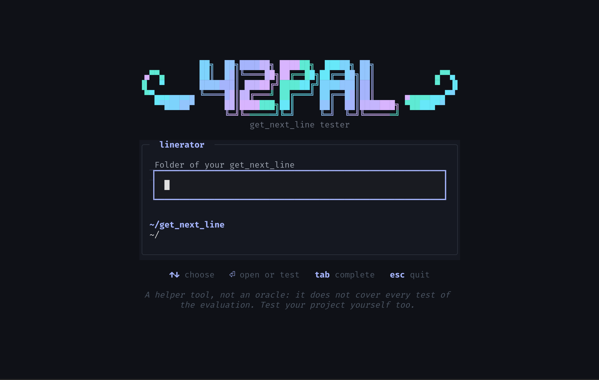
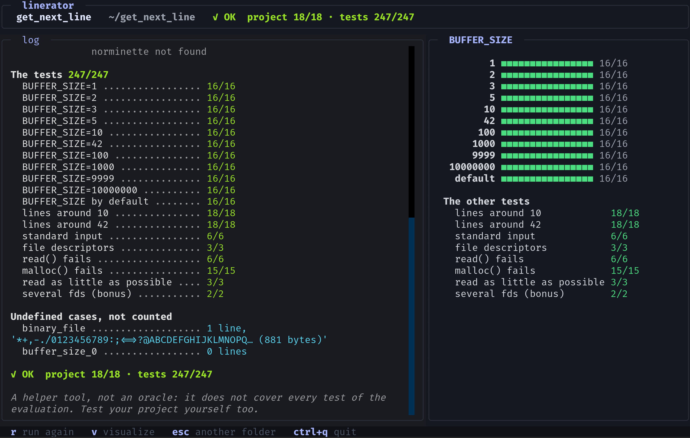
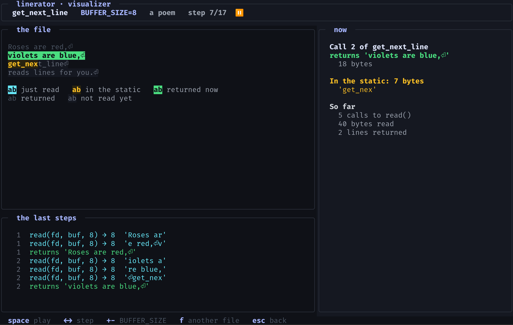

# Linerator

<p align="center">
  
</p>

A tester for **get_next_line**. It checks your files, your header, the build with and without
`-D BUFFER_SIZE`, what the subject forbids, the README and the norm. Then it reads hundreds of files with
eleven values of `BUFFER_SIZE`, from 1 to 10000000. It reads from the standard input and from bad file
descriptors. It makes `read()` and each `malloc()` fail, checks that you read as little as possible, and
tries the bonus with several fds. The runs are checked for leaks and for memory errors. Everything shows
live. A visualizer plays your get_next_line `read()` after `read()`: what each one brings, what waits in
your static, each line returned.

> A helper tool, not an oracle: it does not cover every test of the evaluation. Test your project yourself
> too.

## Install

Nothing to install: Python 3.10 or newer (the system one on the campus machines) and `cc`.

```sh
git clone https://github.com/Blaeste/Linerator.git linerator
cd linerator
./linerator
```

It runs on Linux and WSL. norminette is optional: without it, the norm is skipped.

## Use it

```sh
./linerator                          # full screen: it finds your get_next_line, or you type its folder
./linerator ../get_next_line         # full screen, this project at once
./linerator ../get_next_line --plain # the report line by line (also when the output is a pipe)
```

In full screen, the first screen lists the get_next_line projects found in your home folder (any folder
with a `get_next_line.c`). The one tested last comes first. Type a path and the list follows it, with the
folders inside (★ for a project, `..` to go up). ↑↓ move, Enter opens a folder or tests a project, Tab
completes.

<p align="center">
  
</p>

During the run, the checks and the failures show as they come. On the side, each `BUFFER_SIZE`, then
each other step, fills up with a cell a test, green or red. Then the whole report. `r` runs again, `v` opens the visualizer, Esc
chooses another folder.

Your project is never touched: Linerator copies it (without the `.o` and `.a` files) and tests the copy.

## What it checks

| Step | Checks |
|---|---|
| Files | `get_next_line.c`, `get_next_line_utils.c` and `get_next_line.h` at the root; the prototype in the header |
| Build | `cc -Wall -Wextra -Werror` with `-D BUFFER_SIZE=42`, and without it (the subject asks for a default value) |
| Code | no libft, no global variable (a `static` at the top of a file counts), no function of the libc but `read`, `malloc` and `free` (`lseek` is forbidden); read in the `.o` files with `nm` |
| README | its first line in italics with your login, the sections Description, Instructions and Resources (with the use of AI), the algorithm explained |
| Norm | norminette on the `.c` and `.h` files |
| Lines | 16 files, each with `BUFFER_SIZE` 1, 2, 3, 5, 10, 42, 100, 1000, 9999 and 10000000, and without `-D`: empty, a single newline, no newline at the end, empty lines, one char, lines around 42, a line of 20000 chars, UTF-8, 2000 random lines. Every line, then `NULL`, then `NULL` again |
| Around `BUFFER_SIZE` | lines from `n - 1` to `2n + 1` chars, with or without their newline, alone or in pairs, for 10 and 42 |
| Standard input | fd 0, from a pipe |
| File descriptors | `-1`, an fd never opened, an fd closed between two calls: `NULL` |
| `read()` fails | `read()` returns -1 at its 1st, 2nd or 3rd call: `NULL` from there, and nothing left allocated. A file read up to the error, then opened again on the same fd, must be read from its start (the static cleared) |
| `malloc()` fails | each `malloc` of a run in turn returns `NULL`: no crash, no leak, the lines before it right |
| Read as little as possible | the bytes read before the first line of a file of 1 MB: at most the line and one `BUFFER_SIZE` (more is a warning, the whole file a failure) |
| Bonus | several fds read in turn, each keeping its own place; one static variable |
| Undefined cases | a binary file, `BUFFER_SIZE=0`: what your get_next_line does, never counted |

Each run can end in `LEAK` (blocks still allocated at the end), `MEMERR` (a double free, a free of
something never allocated), `OOB` (a read or a write outside a block), `CRASH` (a signal, like SIGSEGV)
or `TIMEOUT`. With `BUFFER_SIZE=10000000`, a crash often means a buffer of `BUFFER_SIZE` on the stack:
the report says so. `malloc`, `free` and `read` go through Linerator: each block sits next to a protected
page, so an access outside it stops at once and the report says how far outside. The random lines come from a seed
(`--seed`): the same seed gives the same files.

## The visualizer

`v` after a run opens it on your get_next_line; `./linerator ../get_next_line --visualize` opens it at
once (42pal opens it this way). A small file is drawn a line a row, each byte a cell. The bytes the last
`read()` brought shine in cyan and the line just returned in green. What waits in your static is yellow.
What was returned turns grey, and what is not read yet stays dim. On the side: the call of get_next_line,
the `read()` and what it gave or the line returned, what is in the static, and the counts so far. Below,
the last steps.

<p align="center">
  
</p>

| Key | Effect |
|---|---|
| Space | play or pause |
| ← → | one step back or forward |
| Home End | the start, the end |
| + - | a bigger or a smaller `BUFFER_SIZE` (1 to 1000: get_next_line is built again) |
| f | another file: a poem, empty lines without a newline at the end, a long line, one line without a newline |
| Esc | back to the report |

## Options

| Option | Effect |
|---|---|
| `--plain` | the report line by line, instead of the full screen |
| `--no-color` | no colors |
| `--seed N` | the seed of the random lines (42 by default) |
| `--timeout S` | seconds a run may take (10 by default) |
| `--only STEPS` | only these steps, comma separated: `lines,limits,stdin,fds,read_errors,malloc_failures,read_little,bonus,info` |
| `--no-norm` | skip the norm |
| `--lang en\|fr` | the language; by default the one of 42pal (`~/.42pal/settings.json`), else English |
| `--visualize` | open the visualizer at once (`--buffer-size N`: its `BUFFER_SIZE` at first, 8 by default) |
| `--json FILE` | the results in JSON |
| `--stream` | each event on a line of JSON, as it comes |
| `--version` | the version |

The exit code is `0` when everything passes, `1` when something fails, `2` for a wrong use.

## For other tools

`--json` and `--stream` follow the contract of [libfterator](https://github.com/Blaeste/Libfterator), so
that 42pal can run Linerator from its Testers menu. The JSON has `"format": 1`, the checks of the project in
`conformity`, each run in `tests`, the `BUFFER_SIZE` that fail in `notes`, and `error` when the tests could
not run. `suites` gives each suite its name in the language chosen and its row in the panel
(`{"key": "buffer_1", "name": "BUFFER_SIZE=1", "group": "BUFFER_SIZE", "label": "1", "tests": 16}`), so that
42pal shows the same names and the same panel. `--stream` gives `start`, `step` (`subject`, then `tests`),
`check`, `plan` (the number of tests and the suites; it may come again, smaller), `phase`, `test` and
`error`.

## Credits

Some cases come from other testers, with thanks:

- the testers of [francinette](https://github.com/xicodomingues/francinette) (MIT, © 2021 Francisco), by fsoares: the file read up to a failed `read()` then opened again, and the lines around
  `BUFFER_SIZE`;
- [gnlTester](https://github.com/Tripouille/gnlTester) by Tripouille: the idea of the files of 41, 42 and
  43 chars, and of empty lines in turn (no code copied).

The memory engine (`engine/alloc.c`, `engine/guard.c`) comes from libfterator.

## For contributors

```sh
python3 -m unittest
```

The tests use a fake get_next_line that reads with stdio, which the subject forbids, so it can never be
handed in. No working get_next_line is in this repository. The interface uses textual and rich, copied
into `vendor/` (see [vendor/README.md](vendor/README.md)); the core (`liner/` outside `cli/`) is standard
library only. The plan, in French, is in [docs/plans/linerator.md](docs/plans/linerator.md).
